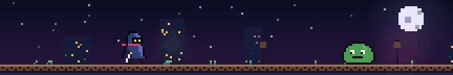

# Aasim Sani

<!-- OPTION A: Capsule Render wave header (replace the # above with this) -->
<!--  -->

<!-- OPTION B: Capsule Render cylinder header -->
<!--  -->

<!-- ═══════════════════════════════════════════════════════ -->
<!-- WIDGET 1: Taglines dissolving out of block glyphs   -->
<!-- like the website's name. scripts/tagline_gif.py      -->
<!-- ═══════════════════════════════════════════════════════ -->

  

## About Me

- Founding Engineer at [Taxwire](https://taxwire.com) — building a sales tax engine
- Previously co-founded [Orai](https://www.orai.com) (AI speech coach, 1M+ users, Forbes 30 Under 30) and [CopyCat](https://copycat-site.webflow.io/) (Figma → React, 20k+ users)
- Into AI, philosophy, food and making complex things simple
- Ex-professional cyclist, certified mountaineer, semi-pro gamer, occasional musician

<!-- ═══════════════════════════════════════════════════════ -->
<!-- WIDGET 2: Snake animation — eats your contribution    -->
<!-- graph. Requires GitHub Action (see .github/workflows) -->
<!-- ═══════════════════════════════════════════════════════ -->

## Contributions

  <!-- SNAKE_DATES:START -->Oct 2025 – Oct 2026<!-- SNAKE_DATES:END -->

<!-- ═══════════════════════════════════════════════════════ -->
<!-- WIDGET 4: Goodreads — auto-updated reading list       -->
<!-- Requires GitHub Action (see .github/workflows)        -->
<!-- ═══════════════════════════════════════════════════════ -->

<!-- Hidden for now. HTML comments can't nest, so the GOODREADS marker comments
are flattened to plain text below. To restore, delete this comment's opening and
closing lines, wrap the four GOODREADS markers back in comment syntax, and
re-enable the cron schedule in .github/workflows/goodreads.yml.

## Currently Reading 📚

GOODREADS:START
- [The City of Brass &lpar;The Daevabad Trilogy, #1&rpar;](https://www.goodreads.com/review/show/8611812010?utm_medium=api&utm_source=rss)
- [Designing Data-Intensive Applications](https://www.goodreads.com/review/show/7270023403?utm_medium=api&utm_source=rss)
GOODREADS:END

## Recently Read 📖

GOODREADS_READ:START
- [Twelve Months &lpar;The Dresden Files, #18&rpar;](https://www.goodreads.com/review/show/5313130200?utm_medium=api&utm_source=rss)
- [Battle Ground &lpar;The Dresden Files, #17&rpar;](https://www.goodreads.com/review/show/5313129568?utm_medium=api&utm_source=rss)
- [Peace Talks &lpar;The Dresden Files, #16&rpar;](https://www.goodreads.com/review/show/5310516010?utm_medium=api&utm_source=rss)
- [Skin Game &lpar;The Dresden Files, #15&rpar;](https://www.goodreads.com/review/show/5313129324?utm_medium=api&utm_source=rss)
- [Cold Days &lpar;The Dresden Files, #14&rpar;](https://www.goodreads.com/review/show/5313129166?utm_medium=api&utm_source=rss)
GOODREADS_READ:END
-->

<!-- ═══════════════════════════════════════════════════════ -->
<!-- BONUS: the website's After-hours boss fight          -->
<!-- scripts/boss_fight_gif.py                             -->
<!-- ═══════════════════════════════════════════════════════ -->

