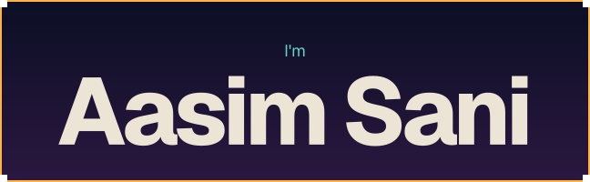

  

<!-- The bio mirrors the "Normal human" stop in aasimsani.github.io/src/data/hype.ts. -->

I'm the founding engineer at <a href="https://taxwire.com">Taxwire</a>, where we automate global sales tax compliance, saving finance teams time and money.

Before this I co-founded <a href="https://orai.com">Orai</a> (Techstars '18, <a href="https://www.forbes.com/30-under-30/2021/education/?profile=orai">Forbes 30 Under 30 in Education</a>), an AI public speaking coach that scaled to 1M+ users. I also co-founded <a href="https://copycat.dev">CopyCat</a>, a generative-AI Figma &rarr; React.js compiler that cut front-end build time by 80% for 20k+ developers. (OnDeck 14, VC-backed.)

Outside work: ex-pro cyclist, certified mountaineer. I read a lot (<a href="https://www.goodreads.com/user/show/67959119-aasim-sani">Goodreads</a>).

  <a href="https://aasimsani.net">Website</a> ·
  <a href="https://aasimsani.net/blog/">Blog</a> ·
  <a href="https://aasimsani.net/resume.pdf">Resume</a> ·
  <a href="https://www.linkedin.com/in/aasimsani/">LinkedIn</a> ·
  <a href="https://twitter.com/aasimsani">X</a>

<!-- ═══════════════════════════════════════════════════════ -->
<!-- WIDGET 2: Snake animation — eats your contribution    -->
<!-- graph. Requires GitHub Action (see .github/workflows) -->
<!-- ═══════════════════════════════════════════════════════ -->

## Contributions

  <!-- SNAKE_DATES:START -->Aug 2025 – Aug 2026<!-- SNAKE_DATES:END -->

<!-- ═══════════════════════════════════════════════════════ -->
<!-- WIDGET 4: Goodreads — auto-updated reading list       -->
<!-- Requires GitHub Action (see .github/workflows)        -->
<!-- ═══════════════════════════════════════════════════════ -->

<!-- Hidden for now. HTML comments can't nest, so the GOODREADS marker comments
are flattened to plain text below. To restore, delete this comment's opening and
closing lines, wrap the four GOODREADS markers back in comment syntax, and
re-enable the cron schedule in .github/workflows/goodreads.yml.

## Currently Reading 📚

GOODREADS:START
- [The City of Brass &lpar;The Daevabad Trilogy, #1&rpar;](https://www.goodreads.com/review/show/8611812010?utm_medium=api&utm_source=rss)
- [Designing Data-Intensive Applications](https://www.goodreads.com/review/show/7270023403?utm_medium=api&utm_source=rss)
GOODREADS:END

## Recently Read 📖

GOODREADS_READ:START
- [Twelve Months &lpar;The Dresden Files, #18&rpar;](https://www.goodreads.com/review/show/5313130200?utm_medium=api&utm_source=rss)
- [Battle Ground &lpar;The Dresden Files, #17&rpar;](https://www.goodreads.com/review/show/5313129568?utm_medium=api&utm_source=rss)
- [Peace Talks &lpar;The Dresden Files, #16&rpar;](https://www.goodreads.com/review/show/5310516010?utm_medium=api&utm_source=rss)
- [Skin Game &lpar;The Dresden Files, #15&rpar;](https://www.goodreads.com/review/show/5313129324?utm_medium=api&utm_source=rss)
- [Cold Days &lpar;The Dresden Files, #14&rpar;](https://www.goodreads.com/review/show/5313129166?utm_medium=api&utm_source=rss)
GOODREADS_READ:END
-->

<!-- ═══════════════════════════════════════════════════════ -->
<!-- BONUS: Capsule Render footer wave                     -->
<!-- ═══════════════════════════════════════════════════════ -->

